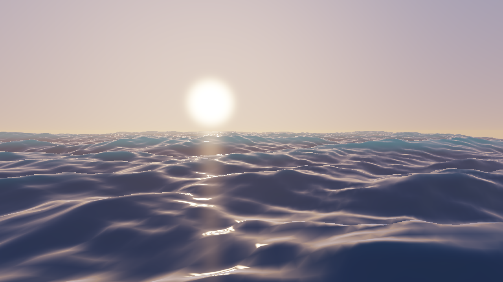
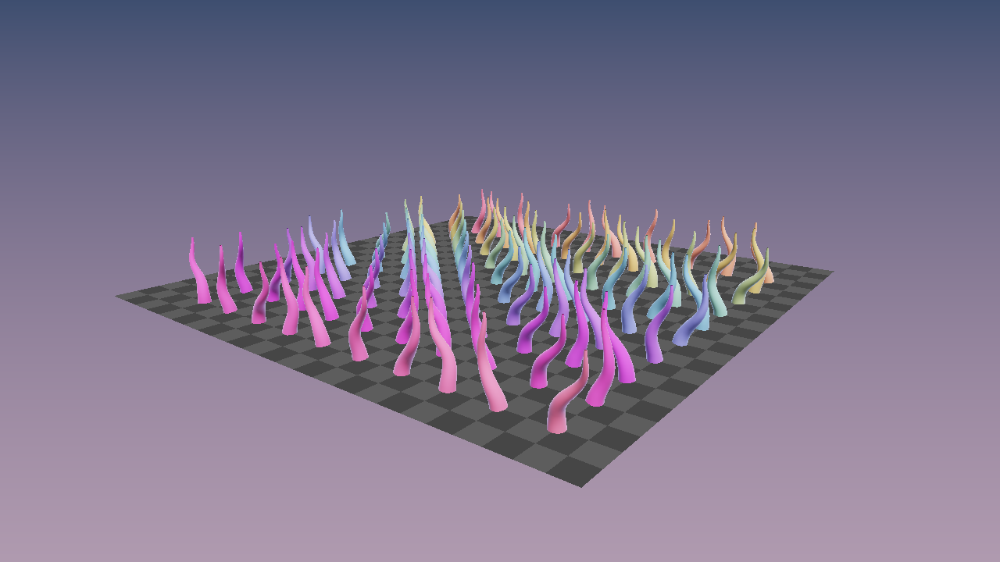
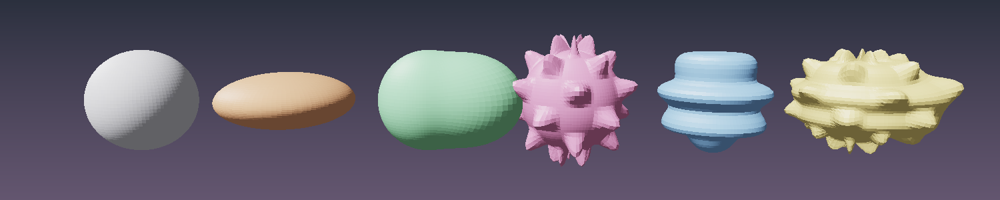
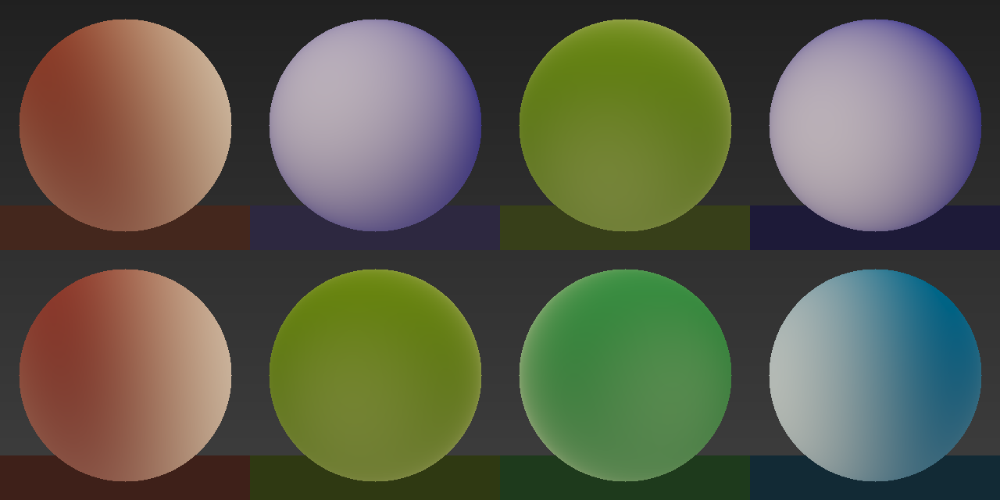
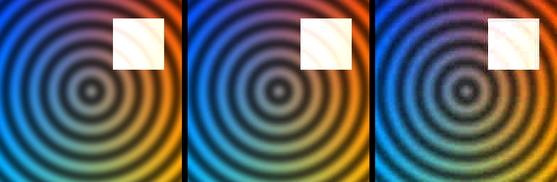

# qanten documentation

qanten is a Rust SDK for Q.ANT photonic NPUs: device access, tensors, neural-network
layers, a simulator, a CLI, and a graphics crate that moves CPU-side 3D work onto the NPU.

> Unofficial community project, not affiliated with or supported by Q.ANT GmbH.

## Start here

- [Getting started](getting-started.md): install, first program, choosing hardware or the simulator.

## `qanten` (core library)

| Guide | Covers |
|---|---|
| [NPUs and backends](qanten/npu.md) | `Npu`, hardware vs simulator, `SimConfig`, custom backends, device info, perf counters |
| [Tensors](qanten/tensor.md) | `Tensor`: creating, reshaping, converting, `ndarray` interop |
| [Operations](qanten/ops.md) | every op in `qanten::ops`, its shapes, and where it runs |
| [Neural networks](qanten/nn.md) | layers, `Sequential`, `StateDict`, loading PyTorch weights |
| [Device memory](qanten/device-memory.md) | `DeviceBuffer<Weights / Features>`, keeping data on the NPU |
| [Errors](qanten/errors.md) | the `Error` enum and what each variant means |
| [Profiling](qanten/profiling.md) | per-op time, data moved, MACs and device memory |

## `qanten-graphics` (3D workloads)

| Guide | Picture |
|---|---|
| [Overview and precision](graphics/README.md) | all five |
| [Ocean waves](graphics/ocean.md) |  |
| [Skinning](graphics/skinning.md) |  |
| [Blendshapes](graphics/blendshapes.md) |  |
| [Light probes (SH)](graphics/sh.md) |  |
| [Block DCT](graphics/dct.md) |  |

## Other crates and tools

- [`qanten-sys`](qanten-sys.md): the raw driver FFI.
- [`qanten` CLI](cli.md): `doctor`, `devices`, `info`, `sensors`, `perf`, `bench`, `selftest`.
- [Testing without hardware](testing.md): the simulator, the mock driver, and a checklist for real cards.
