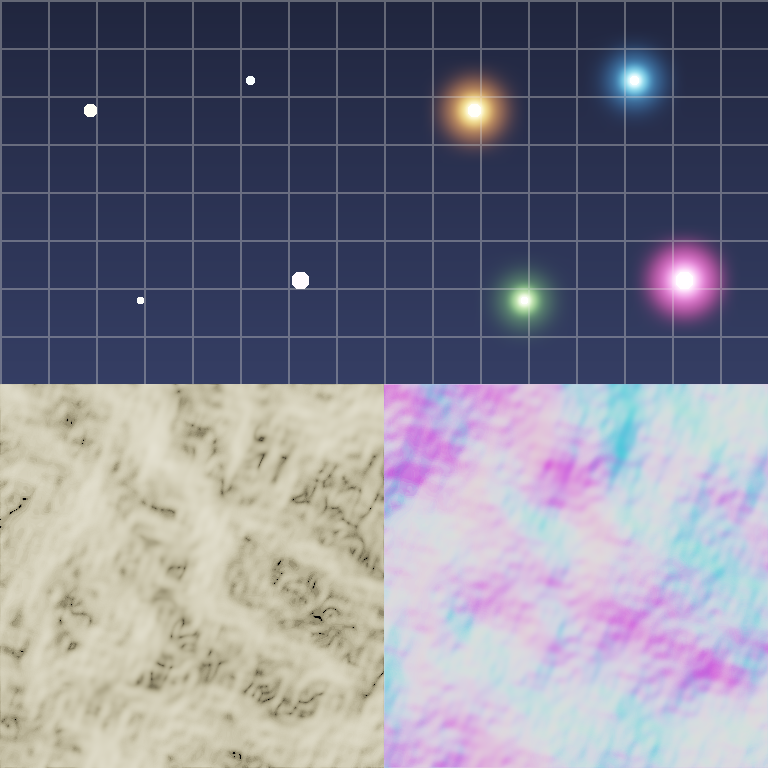

# Image filters (`qanten_graphics::filters`)



*Top: an HDR scene and its bloom (three blur radii, three channels, two NPU calls).
Bottom: Sobel edges and a normal map from a terrain height map.*

Texture and image pipelines (mip generation, bloom, edge detection, normal maps from
height maps) as resident matrices on the NPU. Images are one `Matrix` per channel
(`height × width`). Every filter processes all channels in the same calls.

## Usage

```rust
use qanten::Npu;
use qanten::compute::Matrix;
use qanten_graphics::filters::{Bloom, Separable, Stencil3x3};

fn main() -> qanten::Result<()> {
    let npu = Npu::auto(0)?;
    let rgb: Vec<Matrix> = (0..3).map(|c| Matrix::from_fn(256, 256, |y, x| {
        ((x * y + c) % 17) as f32 / 4.0
    })).collect();

    // Gaussian blur: two NPU calls for all three channels.
    let blurred = Separable::gaussian(256, 256, 3.0).with_npu(&npu)?.apply(&rgb)?;
    // One mip level down.
    let mip = Separable::downsample(256, 256).with_npu(&npu)?.apply(&rgb)?;
    assert_eq!(mip[0].shape(), (128, 128));
    // Bloom at three radii: still two calls.
    let bloom = Bloom::new(256, 256, &[2.0, 6.0, 16.0], 1.0, 0.8)?.with_npu(&npu)?;
    let glowing = bloom.apply(&rgb)?;
    // Sobel edges and a tangent-space normal map from a height map.
    let sobel = Stencil3x3::sobel().with_npu(&npu)?;
    let edges = sobel.edges(&rgb[0])?;
    let normals = sobel.normal_map(&rgb[0], 2.0)?;
    assert_eq!((blurred.len(), glowing.len(), edges.rows(), normals.len()), (3, 3, 256, 256 * 256));
    Ok(())
}
```

## API

| Item | Purpose |
|---|---|
| `gaussian_matrix(n, sigma)`, `downsample_matrix(n)` | the 1-D filters as matrices (clamped edges) |
| `Separable::new(row, col)` | any filter `out = C · X · Rᵀ` per channel |
| `Separable::gaussian(w, h, sigma)`, `Separable::downsample(w, h)` | blur, one mip level (`[1 3 3 1]/8` tent) |
| `Bloom::new(w, h, &sigmas, threshold, intensity)` | `image + intensity · mean_k blur_k(max(image − threshold, 0))` |
| `Stencil3x3::new(&kernels)`, `sobel()`, `sharpen(amount)` | several 3×3 kernels at once |
| `Stencil3x3::edges(&img)`, `normal_map(&height, strength)` | Sobel magnitude, normals `normalize(−s·∂h/∂x, −s·∂h/∂y, 1)` |
| `apply(&channels)` / `apply_cpu(&channels)` | NPU (or CPU without one) / exact reference |
| `.with_npu(&npu)`, `.with_pool(&pool)`, `self_check()` | as in every graphics module |

## How it maps to the NPU

- **Separable filters**: a 1-D filter along rows is a banded `out_w × w` matrix. All rows
  of all channels go through it in one product. The columns (rows of the transposed
  intermediate) go through the `out_h × h` matrix in a second one.
- **Bloom**: the row matrices of all K radii are stacked (`K·w × w`), so every row comes
  back blurred at every radius in one call. The weighted column matrices sit side by
  side (`h × K·h`), so the column call blurs and sums the radii together. Two calls,
  whatever K.
- **Stencils**: the im2row formulation behind `ops::conv2d`. Each pixel's 3×3
  neighbourhood becomes a row of 9 values, and the resident `kernels × 9` matrix gives
  all responses. This is bandwidth-bound (9 values in per pixel), so it pays off mainly
  when batched with other NPU work; the separable filters do far more work per value
  sent.

## Accuracy

The relative error is about 0.1 % for blur and bloom. For normal maps, generate the height
map exactly (for example `Terrain::tiles_cpu`): Sobel amplifies any bf16 noise already
in the input.

## Example

```sh
cargo run --release -p qanten-graphics --example filters -- [out.png]
```
