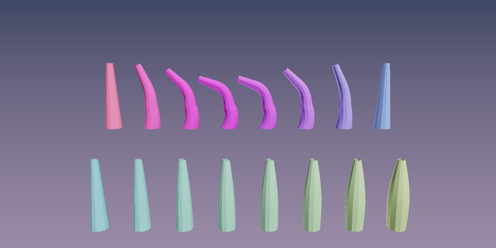

# Loading glTF (`qanten_graphics::gltf`, feature `gltf`)



*`tentacle.glb`: the `Bend` clip sampled at eight times and skinned in one NPU call
(top), and its morph target at weights 0 to 1 in another (bottom).*

`GltfScene` loads `.gltf` (embedded or side-by-side buffers) and `.glb` files into the
graphics types, so an exported character can go straight into
[skinning](skinning.md) and [blendshapes](blendshapes.md).

```toml
qanten-graphics = { version = "0.1", features = ["gltf"] }
```

## Usage

<!-- doccheck: no_run -->
```rust
use qanten::Npu;
use qanten_graphics::gltf::GltfScene;

fn main() -> qanten::Result<()> {
    let npu = Npu::auto(0)?;
    let scene = GltfScene::load("character.glb")?;

    // Skin + skeleton, uploaded to the NPU.
    let model = scene.skinned_mesh(0)?;
    let mesh = model.mesh.with_npu(&npu)?;

    // A crowd playing the same clip at different times: one NPU call.
    let walk = scene.animation("Walk").expect("the file has a Walk clip");
    let poses: Vec<_> = (0..100)
        .map(|c| walk.skinning_matrices(&model.skin, c as f32 * 0.01 * walk.duration()))
        .collect();
    let crowd = mesh.skin_batch(&poses)?;

    // Morph targets, with the weights the file animates.
    let face = scene.blendshapes(1)?;
    let pose = scene.animation("Talk").expect("clip").sample(0.4);
    let weights = face
        .node
        .and_then(|n| pose.morph_weights(n))
        .map_or(face.default_weights.clone(), <[f32]>::to_vec);
    let vertices = face.shapes.evaluate(&weights)?;
    println!("{} characters, {} face vertices", crowd.len(), vertices.len());
    Ok(())
}
```

## API

| Item | Purpose |
|---|---|
| `GltfScene::load(path)` / `from_slice(bytes, base_dir)` | parse `.gltf` / `.glb`; external buffers resolve against `base_dir` |
| `mesh(i)` | `MeshData { positions, normals, triangles }`: all triangle primitives merged |
| `skinned_mesh(i)` | `SkinnedModel { mesh: SkinnedMesh, skin: Skin, node, triangles }` |
| `blendshapes(i)` | `MorphModel { shapes: Blendshapes, default_weights, node, triangles }` |
| `animation(name)`, `animation_at(i)`, `animation_names()` | a `Clip` |
| `Clip::sample(t)` | a `Pose`: every node's transform at `t` (clamped to the clip) |
| `Clip::skinning_matrices(&skin, t)` | `global(joint) · inverse_bind(joint)` for each joint |
| `Pose::node_transform(n)`, `local(n)`, `morph_weights(n)` | world matrix, local TRS, animated weights |
| `rest_pose()`, `parent(n)`, `node_names()`, `mesh_names()` | the scene without animation, hierarchy and names |

## What is supported

- Triangles, triangle strips and fans (strips and fans become triangles); points and
  lines are rejected.
- `JOINTS_0` / `WEIGHTS_0` with `u8`/`u16` joints and float or normalized integer weights.
  Bone `k` of the `SkinnedMesh` is joint `k` of the skin.
- Morph target positions (normals and tangents are read for validation but not used).
- Animation channels for translation, rotation, scale and morph weights, with `STEP`,
  `LINEAR` (rotations use slerp) and `CUBICSPLINE` interpolation.
- Not read: materials, textures, cameras, lights, more than one joint/weight set.

As the glTF spec says, the transform of the node that holds a skinned mesh is ignored:
skinned positions come out in the skeleton's space.

## Untrusted files

Asset files often come from outside. The loader:

- bounds-checks every accessor (offsets, strides and counts, with overflow-checked
  arithmetic) against its buffer view and buffer before anything is read;
- checks each accessor's type against its use (a `VEC2` cannot pose as `POSITION`);
- rejects node hierarchies with cycles or nodes with two parents;
- loads external buffers only from plain relative paths in the asset's folder (no `..`,
  absolute paths or URLs), and at most 1 GiB per buffer;
- adds the checks the `gltf` crate's own validation misses (animation targets,
  `POSITION` accessor indices), found by fuzzing.

A fuzz test mutates the numbers in a glTF document and the bytes of a `.glb` and checks
that loading, skinning and sampling never panic.

## Test assets

`crates/qanten-graphics/tests/data/gltf/make_assets.py` writes the test assets (a skinned,
morphing tentacle with four clips covering every interpolation mode) as `.gltf`, `.glb`
and `.gltf` + `.bin`, using only the Python standard library.

## Example

```sh
cargo run --release -p qanten-graphics --features gltf --example gltf -- [model.glb] [out.png]
```
