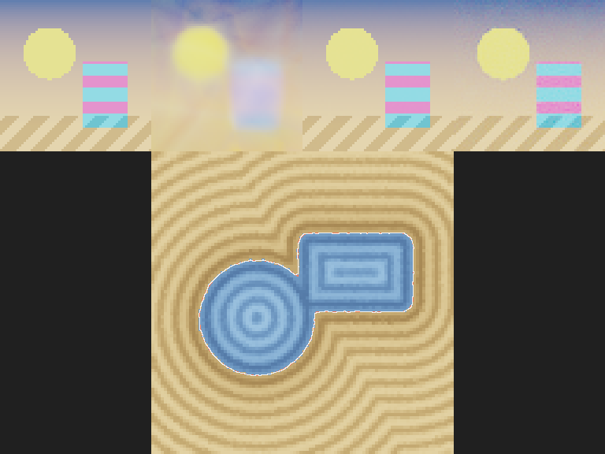

# Neural fields on the NPU



*Top: the 64×64 target, then a ReLU MLP on raw coordinates, a ReLU MLP on Fourier
features, and a SIREN, each trained for 600 steps on the NPU. Bottom: a SIREN
fitted to a 2-D signed distance field. The learned zero contour (white, from marching
squares) lies on top of the exact one (red).*

A neural field is a small network that maps coordinates to values: pixel position →
colour, point → signed distance. Training one is matrix products (on the NPU, in bf16
with f32 master weights) plus periodic functions, which the NPU computes natively.

| Approach | Layers | Notes |
|---|---|---|
| ReLU MLP on `(x, y)` | `train::Dense`, `Relu` | spectral bias: learns low frequencies first, stays blurry |
| Fourier features | `nn::FourierFeatures::encode` once, then `Dense` + `Relu` | sharp; `σ` sets the finest detail (and how soon it fits noise) |
| SIREN | `train::siren(npu, &[2, 128, 128, 3], 30.0, seed)` | sine activations on the NPU, special initialisation; smooth derivatives (good for SDFs) |

See [training](../qanten/training.md#neural-fields-siren-fourier-features) for the API
and how phases stay accurate in bf16.

## Example

```sh
cargo run --release -p qanten-graphics --example neural_fields -- [out.png] [steps]
```

It prints the PSNR of each image fit (on the training pixels) and the RMS distance
error of the SDF. With 600 steps on the simulator:

| Network | Result |
|---|---|
| ReLU MLP on `(x, y)` | 18.5 dB |
| Fourier features (σ = 6, 128 frequencies) + ReLU | 55.8 dB |
| SIREN (ω₀ = 30) | 35.1 dB |
| SDF SIREN | RMS distance error 0.0037 (the shape spans 2 units) |

On the built-in simulator a step over the 4096 pixels takes about 0.1–0.25 s, so the
default 400 steps per network take a few minutes.

The marching-squares helper in the example extracts the zero contour of any sampled
2-D field. A 3-D SDF works the same way with a `[3, …, 1]` SIREN and marching cubes.
