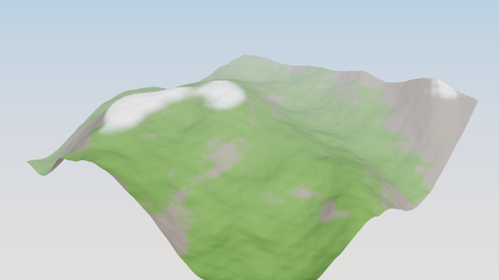

# Procedural terrain (`qanten_graphics::terrain`)



*Nine 256 m tiles (129×129 samples, 96 waves) in one NPU call, shaded by height and
slope: rock where the slope mask says > 35°, snow on high, flat ground.*

Heightfields made of plane waves with a power-law spectrum: the larger the wavelength,
the taller the wave (`amplitude ∝ λ^roughness`), which gives the familiar fBm look of
rolling hills with finer detail on top. The terrain is static, so engines can generate
tiles ahead of the camera in background batches while gameplay asks for exact heights.

## Usage

```rust
use qanten::Npu;
use qanten_graphics::glam::Vec2;
use qanten_graphics::terrain::{Terrain, fbm_spectrum};

fn main() -> qanten::Result<()> {
    let npu = Npu::auto(0)?;
    // 96 waves from 1200 m down to 4 m; the tallest is 45 m high.
    let waves = fbm_spectrum(96, 1200.0, 4.0, 45.0, 1.6, 11);
    let terrain = Terrain::new(waves, Vec2::splat(256.0), 129, 129)?.with_npu(&npu)?;

    // A ring of tiles around the camera: one NPU call.
    let origins: Vec<Vec2> = (0..9)
        .map(|k| Vec2::new((k % 3) as f32 - 1.0, (k / 3) as f32 - 1.0) * 256.0)
        .collect();
    let tiles = terrain.tiles(&origins)?;
    let rock = tiles[0].slope_mask(35f32.to_radians()); // true on cliffs

    // Gameplay: exact f64 height and normal anywhere.
    let h = terrain.height_at(100.0, -40.0);
    let n = terrain.normal_at(100.0, -40.0);
    assert_eq!(tiles.len(), 9);
    assert_eq!(rock.len(), 129 * 129);
    println!("{h} {n}");
    Ok(())
}
```

## API

| Item | Purpose |
|---|---|
| `PlaneWave { direction, wavelength, amplitude, phase }` | one component of the spectrum |
| `fbm_spectrum(count, longest, shortest, height, roughness, seed)` | geometric wavelengths, random directions/phases, `amplitude = height · (λ/longest)^roughness` |
| `Terrain::new(waves, tile_size, nx, nz)` | tiles of a fixed size and resolution; neighbouring tiles share border samples |
| `.with_npu(&npu)` / `.with_pool(&pool)` | uploads the tile-local x table |
| `tile(origin)`, `tiles(&origins)` | `TerrainTile { heights, normals, origin, spacing, nx, nz }`; many tiles in one call |
| `tiles_cpu(&origins)` | exact f64 reference |
| `height_at(x, z)`, `normal_at(x, z)` | exact point queries for physics and placement |
| `TerrainTile::position(i, j)`, `slopes()`, `slope_mask(max_angle)` | world positions, slope angles, cliff masks |
| `self_check()`, `max_height()` | NPU accuracy, upper bound on `|height|` |

## How it maps to the NPU

`h(x, z) = Σ A sin(a x + b z + φ)`. Inside a tile with origin `(x₀, z₀)`, write
`x = x₀ + u`. The angle-sum formula splits each term into an x-side factor that depends
only on the local `u` and a z-side factor that holds the rest:

    Σ A sin θ = Σ (A cos ψ) sin(a u) + (A sin ψ) cos(a u),   ψ = a x₀ + b z + φ

So the `Nx × 2W` table `[cos(a u) | sin(a u)]` is the same for every tile of that size.
It is uploaded once and stays on the NPU. A tile sends `3·Nz` rows (height and both
slopes), and a batch of tiles is one call. The same trick drives the [ocean](ocean.md).
Phases are reduced modulo 2π in f64 on the host, so tiles far from the origin are as
accurate as tiles near it.

## Accuracy

The NPU computes in bf16. Expect height errors of about 0.2 % of `max_height()`
(0.8 m on ±500 m of possible relief in the example) and normal errors of a few
hundredths. That is fine for rendering and streaming. Use `height_at` for
physics and object placement, and `tiles_cpu` for height maps you will
differentiate again (normal maps), since differentiating amplifies bf16 noise.

## Example

```sh
cargo run --release -p qanten-graphics --example terrain -- [out.png]
```
