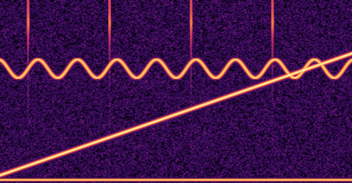

# Signal processing (`qanten::signal`)



*Three seconds of a synthetic recording at 16 kHz: a rising chirp, a warbling 5 kHz
tone, a 120 Hz hum, and four short clicks (the vertical lines). 495 frames × 257 bins
in one NPU call (`cargo run --release -p qanten --example spectrogram`).*

Every tool keeps one constant matrix resident on the NPU and streams all frames or
windows of a signal through it in a single batched call.

| Type | Matrix on the NPU | Vectors streamed |
|---|---|---|
| `Dft` | DFT `cos` / `sin` rows | frames |
| `Stft` | Hann-windowed DFT rows | overlapping frames → spectrogram |
| `FirBank` | every filter at every shift within a block | signal blocks |
| `correlate` | every template at every shift within a block | signal blocks → match scores |

## Spectrograms

```rust
use qanten::signal::Stft;
use qanten::Npu;

fn main() -> qanten::Result<()> {
    let npu = Npu::auto(0)?;
    let rate = 8000.0;
    let signal: Vec<f32> = (0..8000).map(|t| (std::f32::consts::TAU * 440.0 * t as f32 / rate).sin()).collect();
    let stft = Stft::new(&npu, 256, 128)?;          // frame, hop
    let spec = stft.spectrogram(&signal)?;
    let peak = stft.bin_frequency(spec.peak_bin(0), rate);
    assert!((peak - 440.0).abs() < 40.0);
    let _db = spec.db();                             // frames × bins, in dB
    Ok(())
}
```

`Dft::new(npu, n).forward(&frames)` does the same for back-to-back frames without a
window. `Spectrum` holds `re` / `im` (`frames × bins`, bins `0..=n/2`) and has
`magnitude()`, `db()` and `peak_bin(frame)`. Angles use `(k·t) mod n` in integer
arithmetic, so the matrix is exact for any length.

## Filter banks

```rust
use qanten::signal::{FirBank, design};
use qanten::Npu;

fn main() -> qanten::Result<()> {
    let npu = Npu::auto(0)?;
    let bank = FirBank::new(&npu, &[
        design::lowpass(0.05, 101),        // cut-offs as fractions of the sample rate
        design::bandpass(0.1, 0.2, 101),
        design::highpass(0.3, 101),
    ])?;
    let signal = vec![0.0f32; 4000];
    let outputs = bank.apply(&signal)?;    // 3 filtered signals, same length, causal
    assert_eq!(outputs.len(), 3);
    Ok(())
}
```

All filters run in one NPU call over all samples. The signal goes over as blocks (block convolution), so each output sample costs about 2 values of traffic instead of one value per tap. In the `machine-monitor` example that cut the data sent to the NPU 52×. `design` builds windowed-sinc filters
(Hamming window); any taps work.

## Template matching

```rust
use qanten::signal;
use qanten::Npu;

fn main() -> qanten::Result<()> {
    let npu = Npu::auto(0)?;
    let template: Vec<f32> = (0..32).map(|i| ((i as f32) * 0.7).sin()).collect();
    let mut sig = vec![0.0f32; 1000];
    sig[400..432].copy_from_slice(&template);
    let scores = signal::correlate(&npu, &sig, &[template])?;  // Pearson correlation per position
    let found = signal::find_matches(&scores, 32, 0.8);
    assert_eq!(found[0].offset, 400);
    Ok(())
}
```

`correlate` returns normalised scores in `[−1, 1]` for every template at every
position; `find_matches` picks local maxima above a threshold.

A correlation detector only knows the template's waveform. A strong signal at the same
frequency as the template (in the example: the chirp sweeping through the click
frequency) also correlates and produces false positives, and loud overlapping sources
lower the true peaks. In the example, clicks at 3 kHz scored 0.45–0.52 and the chirp
caused a run of false hits; at 7 kHz, where nothing else sounds, the four clicks are
found exactly. Pick thresholds on representative data.

## Precision

bfloat16 gives roughly 40–50 dB of dynamic range, and each frame is normalised to unit
peak before it goes to the NPU, so quiet frames keep their relative accuracy. The DFT
matches an f64 reference within 2 % of the peak magnitude in the tests. That's good
for spectrograms, detection, feature extraction and monitoring, not for producing
hi-fi audio.
